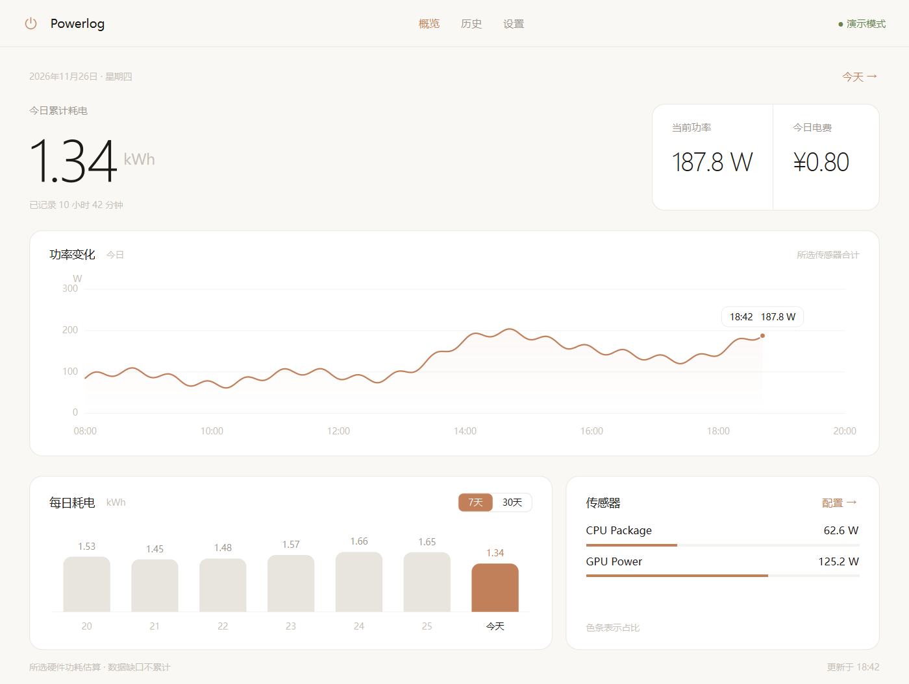
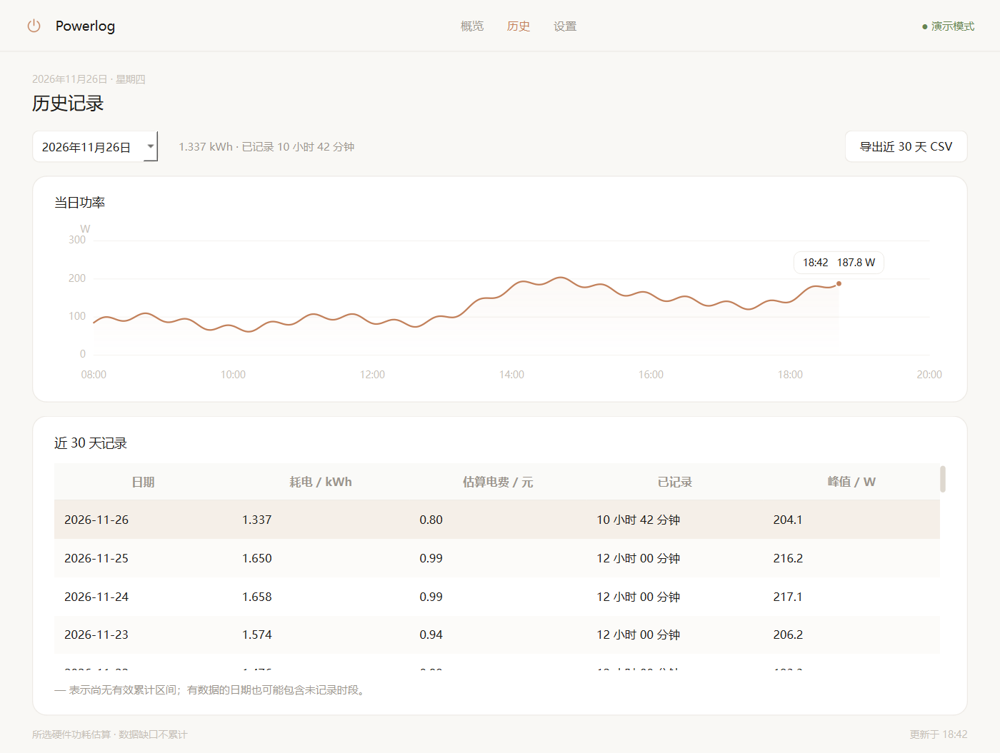
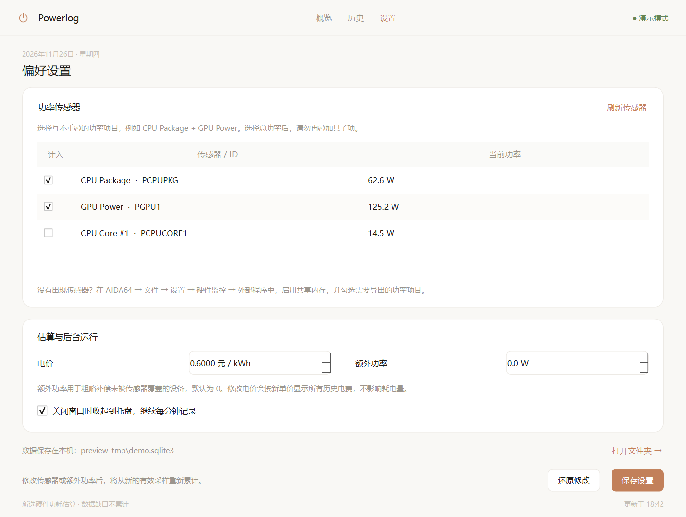

<div align="center">

# 电量 · Powerlog

一个安静、克制的 Windows 桌面耗电记录工具。  
暖奶油纸面、赤陶曲线与轻量排版，只读读取 AIDA64 共享内存，在本地估算每日用电量与电费。


-9B958D?style=flat-square)


<br>



</div>

<details>
<summary><strong>更多界面截图（历史记录 · 偏好设置）</strong></summary>

| 历史记录 | 偏好设置 |
| :---: | :---: |
|  |  |

</details>

---

## 特性

- **零侵入采集**：每 60 秒只读访问 AIDA64 `AIDA64_SensorValues` 共享内存，不修改系统配置，不联网，不上传任何数据。
- **自选功率组合**：自由勾选需要统计的传感器（如 `CPU Package + GPU Power`），支持设置固定额外功率（W）与自定义电价。
- **清晰趋势视图**：当日平滑功率曲线（支持悬停读数）、7 / 30 天每日耗电柱状图、实时传感器占比条与历史单日回溯。
- **严谨累计口径**：基于梯形法积分，对断线、休眠、修改传感器或时间回退等异常自动断链，绝不虚构空档电量。
- **后台静默驻留**：关闭窗口默认收起到系统托盘继续记录；支持一键导出近 30 天 UTF-8 BOM CSV，方便 Excel 直接查看。

---

## 快速上手

### 1. 准备 AIDA64

需要支持外部程序共享内存的 AIDA64 版本（Windows 10 / 11 推荐 x64）：

1. 启动 AIDA64，打开 **文件 → 设置 → 硬件监控 → 外部程序**。
2. 勾选 **启用共享内存**，并在下方勾选需要导出的功率传感器（如 `CPU Package`、`GPU Power`）。

### 2. 运行 Powerlog

**方式 A：直接运行打包版本**

下载或构建生成的 `dist\Powerlog\Powerlog.exe`（需保留同级的 `_internal` 文件夹），双击启动即可。

**方式 B：从源码通过 `uv` 运行**

先安装 [uv](https://docs.astral.sh/uv/getting-started/installation/)：

```powershell
winget install --id astral-sh.uv -e
```

在项目目录中启动：

```powershell
cd power-monitor
uv run --locked powerlog
```

之后也可以直接双击 `run-windows.bat`。

### 3. 首次配置

1. 切换到顶部 **设置** 页面，点击 **刷新传感器**。
2. 勾选互不重叠的功率项目，设置电价（元 / kWh）并保存。
3. 取得第一条有效采样后显示当前功率；自下一条采样起开始累计耗电。

> **避免重复计算**：勾选 `CPU Package` 后请勿再叠加各核心功率；若选择了覆盖整机的 PSU / 系统总功率，请勿再叠加其子项。

---

## 演示模式

无需运行 AIDA64 即可预览完整界面与交互：

```powershell
uv run --locked powerlog --demo
```

- 默认在系统临时目录生成 7 天虚拟记录，退出自动清理，不会读取 AIDA64 也不会影响真实数据。
- 若需保留演示数据库用于预览，可指定目录（会使用独立的 `demo.sqlite3`）：

```powershell
uv run --locked powerlog --demo --data-dir .\preview
```

---

## 估算口径

相邻两条有效采样之间采用梯形法积分：

```text
耗电量 (kWh) = (上次功率 W + 本次功率 W) / 2 × 间隔秒数 / 3,600,000
```

- **断链与空档**：采样间隔超过 90 秒、共享内存读取失败、已选传感器缺失、修改传感器组合或额外功率时，均断开累计链；空档不按零功率或最后功率推算。
- **跨日与时区**：跨本地午夜的区间按时间与线性功率插值拆分为两天；历史记录按当前系统本地时区自动归组。
- **防重复计费**：系统时间回退时，早于已有最新记录的采样会被拒绝。
- **电价与统计范围**：修改电价仅重新计算界面和导出中的电费显示，不改写原始耗电量；CPU / GPU 传感器之和反映所选硬件估算功耗，通常低于插座侧整机功耗。

---

## 数据、备份与隐私

- **完全本地**：所有数据保存在本机 SQLite（Windows 默认路径为 `%LOCALAPPDATA%\Powerlog\powerlog.sqlite3`），可在 **设置 → 打开文件夹** 直接定位。
- **自定义目录与单实例锁**：可通过 `--data-dir <目录>` 指定数据位置；同一数据目录通过 `.lock` 文件保证单实例运行。
- **安全备份**：先从托盘右键 **退出并停止记录**，再复制 `powerlog.sqlite3`。
- **CSV 导出**：历史页可导出近 30 天每日汇总（UTF-8 BOM 编码），包含日期、耗电量、估算电费、已记录时长、峰值功率及当前电价。

---

## 打包与开发

### 打包 Windows 可执行文件

在 Windows 上运行：

```powershell
powershell -NoProfile -ExecutionPolicy Bypass -File .\build-windows.ps1
```

脚本会自动同步锁定依赖、运行 lint 与测试，并通过 PyInstaller 生成 `dist\Powerlog\Powerlog.exe`。

### 代码检查与测试

```powershell
uv sync --locked --all-groups
uv run --locked ruff check src tests
uv run --locked ruff format --check src tests
uv run --locked pytest -q
```

在无图形界面的环境中（如 Linux CI）可执行离线渲染截图检查：

```sh
QT_QPA_PLATFORM=offscreen uv run --locked powerlog --demo --screenshot preview.png
```

---

## License

GNU General Public License v3.0 (GPL-3.0) — see [LICENSE](LICENSE).
